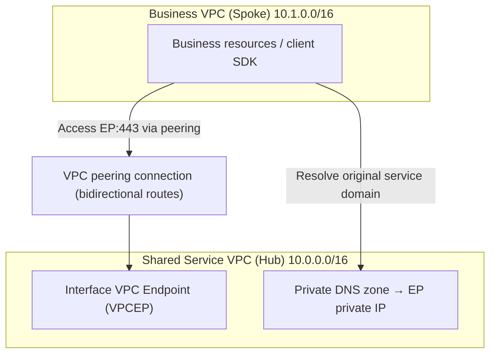

# distributed-x-infrastructure-centralized-vpc-endpoints

[](LICENSE)
[](https://www.huaweicloud.com)
[](https://www.terraform.io)

## 1. Overview

### Introduction

In a multi-VPC environment, creating an interface VPC endpoint separately for each business VPC leads to duplicated construction. This practice adopts a **Hub & Spoke** architecture: interface endpoints are created centrally in a unified "shared service VPC (Hub)", and then reused transparently by each business VPC (Spoke) through **private DNS zone override** and **cross-VPC association**. This simplifies operations and meets the security requirement that private access never traverses the public network.

---

## 2. Table of Contents

- [1. Overview](#1-overview)
- [2. Table of Contents](#2-table-of-contents)
- [3. Architecture Diagram](#3-architecture-diagram)
- [4. Highlights](#4-highlights)
- [5. Cloud Services Used](#5-cloud-services-used)
- [6. Prerequisites](#6-prerequisites)
- [7. Quick Start](#7-quick-start)
- [8. Step-by-Step Deployment](#8-step-by-step-deployment)
- [9. Usage / Verification](#9-usage--verification)
- [10. Cleanup](#10-cleanup)
- [11. Detailed Explanation](#11-detailed-explanation)
- [12. Dependencies](#12-dependencies)
- [13. FAQ / Troubleshooting](#13-faq--troubleshooting)
- [14. Contributing](#14-contributing)
- [15. License](#15-license)
- [16. Contact / Maintainers](#16-contact--maintainers)

---

## 3. Architecture Diagram



---

## 4. Highlights

- **Centralized construction**: endpoints are created only once and reused by multiple VPCs, avoiding duplicated construction.
- **Transparent to business**: the private DNS zone overrides the original service domain, so existing client SDKs need no changes.
- **Simplified architecture**: cross-account DNS override is achieved with the native "private zone ↔ VPC association" capability, with no functions to deploy.
- **Pure private network**: traffic is delivered inside the private network through the peering connection and never leaves for the public network.

---

## 5. Cloud Services Used

| Service | Purpose | Notes |
|---|---|---|
| VPC | Isolated network address space hosting Hub / Spoke | Hub: 10.0.0.0/16, Spoke: 10.1.0.0/16 |
| VPCEP | Interface endpoints carrying centralized private access | System service name varies by region |
| DNS | Private DNS zone + A record | Transparently overrides the original service domain |
| ECS | Test machine for business logic verification | s6.small.1 temporary resource |
| Security Group / VPC Peering | Network connectivity and access control | ICMP/SSH inside Spoke allowed by default |

> **Tip**: all services can be created with one click through this repository's Terraform code. For cleanup, see [Section 10 "Cleanup"](#10-cleanup).

---

## 6. Prerequisites

- A Huawei Cloud account with permissions to create VPC / VPCEP / DNS resources;
- Terraform >= 1.5 (validated with 1.9.8 in this practice; provider `huaweicloud/huaweicloud` ~> 1.70, 1.96.1 also validated);
- Default region `cn-north-4` (when changing regions, check `public_service_name` and `zone_name` accordingly);
- Credentials are provided through environment variables (**do not write them into code or configuration files**):
```bash
export HW_ACCESS_KEY="<HW_ACCESS_KEY>"
export HW_SECRET_KEY="<HW_SECRET_KEY>"
# Temporary credentials are optional: export HW_SECURITY_TOKEN="<TOKEN>"
```

---

## 7. Quick Start

```bash
cd infra
terraform init
terraform plan
terraform apply
```

---

## 8. Step-by-Step Deployment

1. **Initialize**: `cd infra && terraform init` (downloads and validates the provider).
2. **Plan**: `terraform plan -out=tfplan` (previews changes and writes them to the tfplan file).
3. **Apply after review**: `terraform apply tfplan` (creates the VPC / subnet / endpoint / private zone according to the plan).
4. **Verify**: refer to the four checks in [Section 9](#9-usage--verification): "endpoint ready / DNS override effective / network connectivity / association effective".
5. **Cleanup**: `terraform destroy` (see [Section 10](#10-cleanup)).

---

## 9. Usage / Verification

### Usage and Verification

1. **Endpoint ready**: in the VPCEP console, confirm the endpoint status is "Available" and record its private IP.
2. **DNS override effective**: on the temporary ECS in the Spoke VPC, run `nslookup dns.cn-north-4.myhuaweicloud.com`; the expected result is the private IP of the Hub endpoint.
3. **Network connectivity**: test connectivity from the Spoke ECS to the endpoint IP on port 443 and confirm it is reachable through the peering connection.
4. **Association effective**: confirm the Spoke VPC appears in the "Associated VPCs" list of the private zone.

After deployment, follow these steps to verify that the business functionality works before considering the delivery complete.

---

## 10. Cleanup

```bash
cd infra
terraform destroy
```

After execution, it is recommended to directly query the console/API to confirm that no Hub/Spoke VPCs, endpoints, or private zones remain.

---

## 11. Detailed Explanation

- **Difference from gateway-type endpoints**: OBS / SFS are gateway-type endpoint services (route-based, with no ENI IP and no DNS override), so they do not fit this interface-type + DNS override pattern. Private access to OBS should use a gateway-type endpoint + routes instead. The interface-type pattern in this practice applies to system interface services such as Cloud Resolve (`dns`) and enterprise-owned private services.
- **Cross-project (multi-account)**: this code is delivered for a single project; cross-project association / peering can be done in the console or via APIs, or by splitting the Hub and Spoke modules with multiple provider configurations.
- **Security source restriction**: the endpoint ENI belongs to the default security group of the Hub VPC by default; tighten it as needed in production, or use network ACLs / an endpoint whitelist (`enable_whitelist`).
- See `docs/architecture.md` and `docs/deployment-guide.md` for the full architecture and adaptation notes.

---

## 12. Dependencies

This practice is maintained by the Huawei Cloud Cloud Operations Department. See `docs/architecture.md` and `docs/deployment-guide.md` for the full architecture and adaptation notes.

---

## 13. FAQ / Troubleshooting

### FAQ

**Q: Why is the demo service `dns` instead of a message queue / OBS?**
A: The message queue service is not exposed as a public interface-type endpoint service (the corresponding service is not exposed as a public VPCEP service); OBS is gateway-type and does not use this pattern. Therefore the system interface service `dns` (Cloud Resolve) is used as a runnable demo, and the service list is parameterized for easy replacement with an actual interface-type service or a self-owned service.

**Q: Can the private zone name be the same as the real service domain?**
A: Yes. Reusing the real domain name (such as `dns.cn-north-4.myhuaweicloud.com`) allows existing clients to resolve transparently; the override only takes effect for VPCs "associated with that private zone". If you do not want to override the real domain during testing, use a synthetic domain instead.

---

## 14. Contributing

Please submit feedback and improvement suggestions through Issues. This repository does not accept direct PRs; all changes are reviewed and merged by the maintainers.

---

## 15. License

This practice is licensed under the **MIT No Attribution** license. See the [`LICENSE`](LICENSE) file in the repository root for details.

This practice is released under the MIT-0 license. See [LICENSE](LICENSE).

---

## 16. Contact / Maintainers
| Item | Content |
|---|---|
| **Creator** | [dgc-git](https://github.com/dgc-git) |
| **Maintainer** | [dgc-git](https://github.com/dgc-git) |
| **Contact** | GitHub Issues / PR (see [Section 14](#14-contributing)) |
