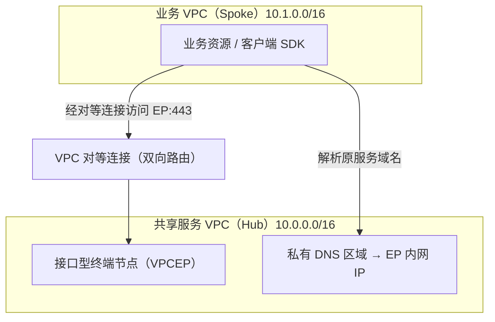

# distributed-x-infrastructure-centralized-vpc-endpoints · 集中化 VPC 终端节点访问实践（Hub & Spoke）

[](LICENSE)
[](https://www.huaweicloud.com)
[](https://www.terraform.io)

## 1. 简介 / Overview

### 简介


在多 VPC 环境中，为每个业务 VPC 单独创建接口型终端节点会带来重复建设。本实践采用 **Hub & Spoke** 架构：在统一的「共享服务 VPC（Hub）」内集中创建接口型终端节点，再通过 **私有 DNS 区域覆盖** 与 **跨 VPC 关联**，让各业务 VPC（Spoke）透明复用这些终端节点，简化运维复杂度，并满足私网访问不出公网的安全要求。

---

## 2. 目录

- [1. 简介 / Overview](#1-简介--overview)
- [2. 目录](#2-目录)
- [3. 架构图](#3-架构图)
- [4. 方案亮点](#4-方案亮点)
- [5. 涉及云服务](#5-涉及云服务)
- [6. 前置条件](#6-前置条件)
- [7. 快速开始](#7-快速开始)
- [8. 分步部署](#8-分步部署)
- [9. 使用方法 / 验证](#9-使用方法--验证)
- [10. 清理资源](#10-清理资源)
- [11. 详细说明](#11-详细说明)
- [12. 依赖](#12-依赖)
- [13. FAQ / 故障排除](#13-faq--故障排除)
- [14. 贡献指南](#14-贡献指南)
- [15. 许可证](#15-许可证)
- [16. 联系方式 / 维护者](#16-联系方式--维护者)

---

## 3. 架构图



---

## 4. 方案亮点

- **集中建设**：终端节点只建一次，多 VPC 复用，避免重复建设。
- **业务无感**：通过私有 DNS 区域覆盖原服务域名，存量客户端 SDK 无需改造。
- **架构简化**：用华为云原生「私有区域 ↔ VPC 关联」完成跨账号 DNS 覆盖，无需部署任何函数。
- **纯私网**：流量经对等连接在私网内送达，不出公网。

---

## 5. 涉及云服务

| 服务 | 用途 | 备注 |
|---|---|---|
| VPC | 隔离的网络地址空间，承载 Hub / Spoke | Hub:10.0.0.0/16,Spoke:10.1.0.0/16 |
| VPCEP | 接口型终端节点，承载集中化私网接入 | 系统服务名按 region 变化 |
| DNS | 私有 DNS 区域 + A 记录 | 透明覆盖原服务域名 |
| ECS | 业务逻辑验证用测试机 | s6.small.1 临时资源 |
| 安全组 / VPC Peering | 网络连通与访问控制 | 默认放通 Spoke 内部 ICMP/SSH |

> **提示**：所有服务均可通过本仓库的 Terraform 一键创建；如需清理，请参见 [第 10 节「清理资源」](#10-清理资源)。

---

## 6. 前置条件

- 华为云账号，具备 VPC / VPCEP / DNS 创建权限；
- Terraform ≥ 1.5（本实践于 1.9.8 验证，provider `huaweicloud/huaweicloud` ~> 1.70，已验证 1.96.1）；
- 默认区域 `cn-north-4`（更换区域须同步核对 `public_service_name` 与 `zone_name`）；
- 凭据通过环境变量提供（**不要写入代码或配置文件**）：
```bash
export HW_ACCESS_KEY="<HW_ACCESS_KEY>"
export HW_SECRET_KEY="<HW_SECRET_KEY>"
# 临时凭证可选：export HW_SECURITY_TOKEN="<TOKEN>"
```

---

## 7. 快速开始

```bash
cd infra
terraform init
terraform plan
terraform apply
```

---

## 8. 分步部署

1. **初始化**：`cd infra && terraform init`（下载 provider 并校验）。
2. **规划**：`terraform plan -out=tfplan`（预演变更并落盘到 tfplan 文件）。
3. **审查后执行**：`terraform apply tfplan`（按预演结果创建 VPC / 子网 / 终端节点 / 私有区域）。
4. **验证**：参见 [第 9 节](#9-使用方法--验证) 的「终端节点就绪 / DNS 覆盖生效 / 网络连通 / 关联生效」四项检查。
5. **清理**：`terraform destroy`（参考 [第 10 节](#10-清理资源)）。

---

## 9. 使用方法 / 验证

### 使用方法与验证


1. **终端节点就绪**：VPCEP 控制台确认终端节点状态「可用」，记录其内网 IP。
2. **DNS 覆盖生效**：在 Spoke VPC 内临时 ECS 执行 `nslookup dns.cn-north-4.myhuaweicloud.com`，预期返回 Hub 终端节点内网 IP。
3. **网络连通**：从 Spoke ECS 对终端节点 IP:443 做连通性测试，确认经对等连接可达。
4. **关联生效**：确认 Spoke VPC 已出现在私有区域的「关联 VPC」列表中。

部署完成后请按本节步骤自行验证，确认业务功能可用，方可视为交付完成。

---

## 10. 清理资源

```bash
cd infra
terraform destroy
```

执行后建议在控制台 API 直查 Hub/Spoke VPC、终端节点、私有区域确无残留。

---

## 11. 详细说明

- **OBS 网关型差异**：OBS / SFS 属网关型终端节点服务（路由型，无 ENI IP、无 DNS 覆盖），不适用本接口型 + DNS 覆盖模式；OBS 私网访问应改用以太网关型终端节点 + 路由。本实践的接口型模式适用于云解析（`dns`）等系统接口服务及企业自有私网服务。
- **跨项目（多账号）**：本代码按同项目交付；跨项目关联 / 对等可在控制台或 API 完成，或通过多 provider 配置拆分 Hub 与 Spoke 模块。
- **安全源限制**：终端节点 ENI 默认归属 Hub VPC 默认安全组，生产环境请按需收紧，或改用网络 ACL / 终端节点白名单（`enable_whitelist`）。
- 完整架构与适配说明见 `docs/architecture.md` 与 `docs/deployment-guide.md`。

---

## 12. 依赖

本实践由华为云持续运营部维护。完整架构与适配说明见 `docs/architecture.md` 与 `docs/deployment-guide.md`。

---

## 13. FAQ / 故障排除

### FAQ


**Q：为什么演示服务是 `dns` 而不是 消息队列/OBS？**
A：消息队列服务未以公共接口型终端节点服务开放（对应服务未以公共 VPCEP 服务开放）；OBS 是网关型，不走本模式。故以系统接口服务 `dns`（云解析）作为可运行演示，并把服务列表参数化，便于替换为实际接口型服务或自有服务。

**Q：私有区域名能和真实服务域名一样吗？**
A：可以。沿用真实域名（如 `dns.cn-north-4.myhuaweicloud.com`）可使存量客户端透明解析；该覆盖仅对「已关联该私有区域的 VPC」生效。测试期若不想覆盖真实域名，可改为合成域名。

---

## 14. 贡献指南

请通过 Issue 提交反馈与改进建议；本仓库不接受直接 PR，统一由维护者评审后合入。

---

## 15. 许可证

本实践采用 **MIT No Attribution** 许可证，详见仓库根目录 [`LICENSE`](LICENSE) 文件。


本实践基于 MIT-0 许可证发布。详见 [LICENSE](LICENSE)。

---

## 16. 联系方式 / 维护者
| 项 | 内容 |
|---|---|
| **创建者** | [dgc-git](https://github.com/dgc-git) |
| **维护者** | [dgc-git](https://github.com/dgc-git) |
| **联系方式** | GitHub Issues / PR（见[第 14 节](#14-贡献指南)） |
