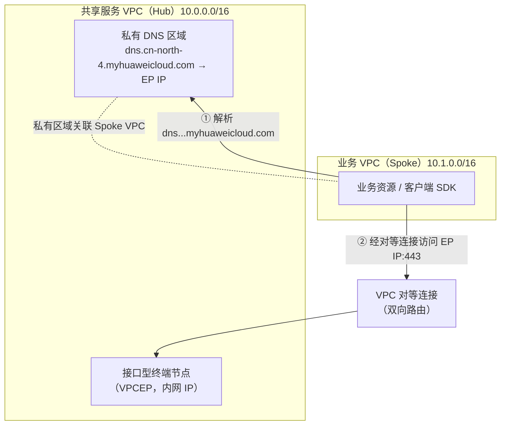

# 集中化 VPC 终端节点访问实践（Hub & Spoke）

## 1. 概述

在多 VPC 环境下，为每个业务 VPC 单独创建接口型终端节点会带来重复建设与运维负担。本实践采用 **Hub & Spoke** 架构：在统一的「共享服务 VPC（Hub）」内集中创建接口型终端节点，再通过 **私有 DNS 区域覆盖** 与 **跨 VPC 关联**，让各业务 VPC（Spoke）透明复用这些终端节点，从而降低运维复杂度，同时满足私网访问不出公网的安全要求。

适用场景：

- 多个 VPC 需要私网访问同一云服务（如云解析等接口型服务）或企业自有私网服务；
- 希望统一管理终端节点、避免重复建设；
- 客户端 SDK 仍以原服务域名为访问目标、不希望改造业务代码。

## 2. 架构图

工作流程：

1. Spoke 内的客户端以原服务域名（如 `dns.cn-north-4.myhuaweicloud.com`）发起请求，Spoke VPC 内部 DNS 因已关联私有区域，将其解析为 Hub 终端节点内网 IP。
2. 流量经 Hub ↔ Spoke 对等连接送达 Hub 终端节点（TCP 443）。
3. 终端节点将请求转发至后端云服务 / 私网服务。

## 3. 核心组件

| 组件 | 华为云资源 | 说明 |
|---|---|---|
| 共享服务 VPC | `huaweicloud_vpc` / `huaweicloud_vpc_subnet` | 集中放置终端节点的 Hub |
| 接口型终端节点 | `huaweicloud_vpcep_endpoint` | 连接公共服务或自有私网服务 |
| 公共服务查询 | `huaweicloud_vpcep_public_services`（data source） | 解析系统预置服务的 `service_id` |
| 私有 DNS 区域 | `huaweicloud_dns_zone`（`zone_type = "private"`） | 覆盖原服务域名解析 |
| A 记录 | `huaweicloud_dns_recordset` | 指向终端节点内网 IP |
| 区域关联 | `huaweicloud_dns_private_zone_associate` | 将 Hub / Spoke VPC 关联到私有区域 |
| 网络连通 | `huaweicloud_vpc_peering_connection` + `huaweicloud_vpc_route` | 提供 Spoke↔Hub 双向可达 |

## 4. OBS 网关型差异（重要）

对象存储服务（OBS）、SFS 等在华为云属于 **网关型** 终端节点服务：

- 网关型终端节点表现为 **路由表下一跳**，没有 ENI 内网 IP，也不支持私有 DNS 覆盖；
- 因此 OBS 的私网访问**不适用本 Hub & Spoke 接口型 + DNS 覆盖模式**；
- 如需集中访问 OBS，应在各 VPC 创建 **网关型终端节点** 并配置对应路由（机制不同，需单独设计）。

本实践的接口型模式适用于：云解析（`dns`）等系统接口服务，以及企业 **自有私网服务**（以 ELB 为后端发布的终端节点服务）。

## 5. 跨项目（多账号）说明

本代码按 **同项目** 交付。若需跨项目复用（类比多账号场景）：

- `huaweicloud_dns_private_zone_associate` 可传入其他项目的 VPC ID 完成关联；
- 对等连接 `huaweicloud_vpc_peering_connection` 支持 `peer_tenant_id`（跨项目）；
- 当前 provider 资源未直接暴露 `project_id` 输入字段，跨项目关联 / 对等可在控制台或 API 完成，或通过「多 provider 配置（分别为不同 project 配置 `huaweicloud` provider）」拆分 Hub 与 Spoke 模块实现。

## 6. 安全建议

- 终端节点 ENI 默认归属 Hub VPC 的默认安全组，请按需收紧或将源限制改为网络 ACL / 终端节点白名单（`enable_whitelist`）；
- 私有区域仅关联可信 VPC，避免 DNS 覆盖被扩散；
- 凭据通过环境变量注入，禁止硬编码（见部署指导书）。
